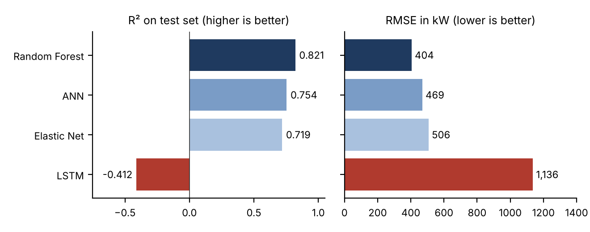

# Solar Power Generation Forecasting

Machine learning models that predict how much power a solar installation will generate from weather and sun-position data, plus a Streamlit app that recommends a solar panel type from local weather conditions.

**Team:** Erica Mathias, Shahood Ansari, Sebastina Eliza | Faculty guide: Prof. Parshvi Shah | Fr. Conceicao Rodrigues College of Engineering, Mumbai, 2023 to 2024

## Why it matters

Solar output swings with cloud cover, humidity and the sun's position, which makes it hard for grid operators to plan. Accurate short-term forecasts help balance supply and demand.

## Results

Four models were compared on **4,213 records** with **20 weather and sun-position features** (temperature, humidity, cloud cover, wind, radiation, sun angle and more). Target: generated power in kW.

| Model | R² | MAE (kW) | RMSE (kW) |
|---|---|---|---|
| **Random Forest** (200 trees, 5-fold grid search) | **0.821** | **253.8** | **404.1** |
| Artificial Neural Network (2 hidden layers) | 0.754 | 302.8 | 468.9 |
| Elastic Net | 0.719 | 390.7 | 506.5 |
| LSTM | -0.412 | 889.4 | 1,135.5 |

**Random Forest won**, explaining about 82% of the variation in power output, with **14% lower RMSE** than the next best model (the neural network). The LSTM performed poorly because the records are not a continuous time series, so a sequence model had no real sequence to learn from.



## Panel recommendation app

`app/app.py` is a Streamlit prototype trained on **8,701 half-hourly Mumbai weather records (2023)**. It:
1. Groups 26 raw weather labels into 6 conditions (Rain, Haze, Fog, Smoke, Mist, Fair)
2. Trains a Random Forest classifier to predict the weather condition from temperature, dew point, humidity, wind and pressure
3. Recommends a panel type for that condition (for example, PERC or thin-film panels for rainy conditions)

```bash
cd app
pip install -r requirements.txt
streamlit run app.py
```

## Files

| File | Purpose |
|---|---|
| `solar_power_forecasting.ipynb` | Full modeling notebook: EDA, feature correlations, Random Forest, ANN, Elastic Net, LSTM, evaluation |
| `app/app.py` | Streamlit panel recommendation app |
| `app/mumbai-2023.csv` | Mumbai weather data used by the app |
| `figures/` | Model comparison, ANN training curve and Lasso feature chart |

The power generation dataset (`solarpowergeneration.csv`, a public solar power generation dataset) is not included. Place it next to the notebook to rerun it.

## Tools

Python, pandas, scikit-learn (Random Forest, Elastic Net, GridSearchCV), TensorFlow/Keras (ANN, LSTM), matplotlib, seaborn, Streamlit
